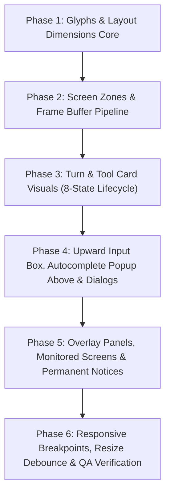

# Tendril CLI Visual Layout Implementation Plan

> Based on: `agent-harness-cli-visual-layout-spec.md` (November 10, 2026)  
> Complements: `new-ins.md` (Behavioral & Architecture Specification)  
> Scope: Text-based Visual Wireframes, Exact Column Layouts, 6 Screen Zones, Glyphs, 8-State Tool Cards, Upward Input Box, Autocomplete Popup Above Input, Responsive Degradation.

---

## Architecture Principles & Visual Contracts

1. **Six-Zone Screen Stack (Strict Order):**
   - **Zone A (Banner):** Session welcome header, printed once, scrolls into terminal scrollback.
   - **Zone B (Conversation):** User queries, assistant text, tool cards, diffs, diagrams. Left-aligned, hanging indent.
   - **Zone C (Live Region):** Dynamic spinner, elapsed active timer, queued messages, activity tray. Re-drawn in place, never leaves artifacts in scrollback.
   - **Zone D (Approval Bar):** Sits above or replaces input box when consent is needed. Shows `(1 of N pending)`.
   - **Zone E (Input Box):** Bordered frame, fixed bottom, expands upward (3 to 10 rows), shell escape `!`, paste chips.
   - **Zone F (Footer):** 1 row: dynamic contextual hint on left, status on right (`<mode> | <model> | ctx <pct>%`).

2. **Visual Dimensions:**
   - Default width: **76 columns**.
   - Maximum content width: `min(terminal_columns - 2, 100)`.
   - Content indent: User message starts at col 0, hanging indent at col 2. Assistant bullet `●` at col 0, text at col 2. Tool result `⎿` at col 2, text at col 5. Exactly 1 blank row between message blocks.
   - Upward growing input box with fixed bottom line.

3. **Glyph Vocabulary:**
   - Single source of truth module (`glyphs.ts`). Pure Unicode by default, pure ASCII fallback when `caps.asciiOnly` or `TENDRIL_ASCII_MODE` is active. Zero emoji.

---

## Phased Implementation Roadmap

---

### Phase 1: Glyphs & Layout Dimensions Core (গ্লিফ ও ডাইমেনশন ভিত্তি)
**Goal:** Establish single-source-of-truth glyph dictionary and dimension/measurement utilities.

- [ ] **Glyphs Vocabulary Module (`packages/cli/src/ui/glyphs.ts`):**
  - Implement complete glyph dictionary supporting both Unicode and ASCII modes:
    - Assistant / Tool Bullet: `●` / `*`
    - Tool Result Connector: `⎿` / `\_`
    - User Prompt: `>` / `>`
    - Spinner (running): `⠋⠙⠹⠸⠼⠴⠦⠧⠇⠏` / `- \ | /`
    - Success: `✓` / `[ok]`
    - Error / Failed: `✗` / `[x]`
    - Waiting: `…` / `...`
    - Thinking: `✻` / `~`
    - Task Open / Done: `☐` / `☒` vs `[ ]` / `[x]`
    - Focus Caret: `▸` / `>`
    - Box Borders: `╭ ╮ ╰ ╯ │ ─ ├ ┤ ┬ ┴ ┼` / `+ | -`
    - Dashed Divider: `┄` / `-`
    - Progress Bar: `█` / `░` vs `#` / `.`
    - Scroll Indicators: `▲ ▼` / `^ v`
    - Review Comment Marker: `▌` / `|`
    - Notices: `i` `!` `x`
  - Automatic fallback based on `capabilities.asciiOnly` or `NO_COLOR` / `TENDRIL_ASCII_MODE`.

- [ ] **ANSI & Unicode Width Calculation (`packages/cli/src/ui/layout-calc.ts`):**
  - String width calculation taking into account zero-width ANSI escapes and wide characters (CJK/emoji).
  - Truncation with trailing ellipsis `…` at exact visible character boundaries.
  - Hanging indent formatter (indent line 2+ while keeping line 1 aligned with bullet).

- [ ] **Unit Tests:**
  - `packages/cli/test/visual-glyphs.test.ts`: test all glyph mappings, ASCII fallbacks, wide-char width calculations, and hanging indents.

---

### Phase 2: Screen Zones & Frame Buffer Pipeline (স্ক্রিন জোন ও পাইপলাইন)
**Goal:** Implement the 6-zone screen stack architecture with clean in-place redraw of the live region.

- [ ] **Zone Orchestrator (`packages/cli/src/render/layout/orchestrator.ts`):**
  - Zone A (Welcome Banner): rendered once at session start; full format (70+ cols) and compact format (<50 cols); strictly real data (model, cwd, mode).
  - Zone B (Conversation): append-only into terminal scrollback.
  - Zone C (Live Region): in-place redraw area (spinner, elapsed time, queued inputs). Cleared cleanly when turn ends so no artifacts linger in scrollback.
  - Zone D (Approval Bar): rendered immediately above or replacing input box when consent is requested.
  - Zone E (Input Box): upward expanding framed box.
  - Zone F (Footer): 1-row contextual status line.

- [ ] **Dynamic Footer Component (`packages/cli/src/components/footer/status-bar.ts`):**
  - Left side: dynamic context hints across 10 states:
    1. Idle: `? for shortcuts`
    2. Typing: `shift+enter newline · esc clear`
    3. Agent running: `esc to interrupt · ctrl+o expand · ctrl+x tray`
    4. Awaiting approval: `enter select · tab add note · esc cancel`
    5. Autocomplete open: `up/down move · tab complete · esc close`
    6. Shell mode: `shell mode · enter run · esc exit shell mode`
    7. Plan mode: `plan mode · shift+tab to leave`
    8. Stop armed: `press ctrl+x again to stop · esc to keep running`
    9. Single Ctrl+C: `press ctrl+c again to exit`
    10. Single Ctrl+Z: `press ctrl+z again to suspend`
  - Right side: `<mode> | <model> | ctx <pct>%` with responsive prioritization (prunes model first, mode second, context % always preserved).

- [ ] **Unit Tests:**
  - `packages/cli/test/visual-zones.test.ts`: test banner formats, zone stacking, live region in-place redraw clear, and dynamic footer states.

---

### Phase 3: Turn & Tool Card Visuals - 8-State Lifecycle (টার্ন ও টুল কার্ড ভিজ্যুয়াল)
**Goal:** Refine conversation turn presentation and tool card visual states to match wireframe specs.

- [ ] **Turn Presentation Alignment (`packages/cli/src/render/conversation/turn-layout.ts`):**
  - User prompt: col 0 `> `, hanging indent at col 2 for line 2+.
  - Assistant message: col 0 `● `, hanging indent at col 2.
  - Thinking block: col 2 `✻ Thinking… (ctrl+o to expand)`.
  - Spacing contract: exactly 1 blank line between blocks; 0 blank lines between tool header and tool result.

- [ ] **8-State Tool Card Visuals (`packages/cli/src/components/tool-cards/visual-card.ts`):**
  - State 1 (Awaiting approval): `● Name(args) \n ⎿ … Waiting for approval`
  - State 2 (Running with live stream): `● Name(args) \n ⎿ ⠹ Running… (<n>s · ctrl+o to expand) \n <live output 3 lines, dim>`
  - State 3 (Done collapsed): `● Name(args) \n ⎿ ✓ Done (exit 0) · <n> lines (ctrl+o to expand)`
  - State 4 (Done expanded - head/tail): `● Name(args) \n ⎿ ✓ Done \n <line 1-3> \n … +N lines hidden \n <line N-2 to N>`
  - State 5 (Failed): `● Name(args) \n ⎿ ✗ Failed (exit <code>) \n <error lines>`
  - State 6 (Denied): `● Name(args) \n ⎿ ✗ Denied by user \n <user note>`
  - State 7 (Interrupted): `● Name(args) \n ⎿ ✗ Interrupted`
  - State 8 (MCP Card): all parameters inline, 16-character progress bar `[██████░░░░░░░░░░]`.
  - Sub-agent Card: `● Agent(<name>) "<one-line prompt preview…>" \n ⎿ ⠹ <n> tool calls · <t>s`.

- [ ] **Unified Diff View Component (`packages/cli/src/render/diff/visual-diff.ts`):**
  - Line numbers right-aligned in fixed-width gutter followed by space.
  - `-` line with `diff.removed` styling; `+` line with `diff.added` styling.
  - 3-line context hunks separated by `···`.
  - Mandatory `+` and `-` glyphs ensuring readability under `NO_COLOR`.

- [ ] **Unit Tests:**
  - `packages/cli/test/visual-tool-cards.test.ts`: test all 8 tool card states, MCP progress bar, subagent prompt preview, and diff formatting.

---

### Phase 4: Upward Input Box, Autocomplete Popup Above & Dialogs (ইনপুট, পপআপ ও অনুমোদন)
**Goal:** Implement the upward-growing input box, autocomplete popup rendered above the box, and approval dialogs taking over the input zone.

- [ ] **Upward Expanding Input Box (`packages/cli/src/components/input/box.ts`):**
  - Single-line placeholder: `╭──╮ \n │ > Ask anything / commands @ files ! shell │ \n ╰──╯`.
  - Multi-line growth: bottom border remains anchored, top border moves up (up to 10 lines).
  - Indent line 2+ with 2-space padding aligned with first line text.
  - Shell mode: prompt changes from `>` to `!`, border switches to `prompt.accent`.
  - Paste chip: `[pasted text <n> lines]`.

- [ ] **Autocomplete Popup Above Input (`packages/cli/src/components/autocomplete/popup.ts`):**
  - Positioned directly **above** the input box (not below).
  - Maximum 8 visible rows with scroll indicator `<n> more ↓`.
  - Selection caret `▸` with bold highlight on active row.
  - Match highlighting: typed query characters rendered with accent, remaining characters dim.
  - Support for `/slash` commands and `@path` file references with trailing `/` on folders and middle path compression (`<dir>/…/<file>`).

- [ ] **Permission & Approval Dialog (`packages/cli/src/components/approval-bar/dialog.ts`):**
  - Replaces input box while awaiting approval (input is paused/hidden).
  - File edit permission with inline diff hunk.
  - Shell command permission with 3-tier trust options (`1. Yes, once`, `2. Trust exact`, `3. Trust prefix`, `4. Trust base`, `5. No with feedback`).
  - Queue header: `(1 of <n> pending)`.
  - `Tab` key opens inline feedback note field.
  - `Trust all tools` confirmation dialog with default focus on `1. No, keep asking`.

- [ ] **Unit Tests:**
  - `packages/cli/test/visual-input-dialogs.test.ts`: test upward box growth, autocomplete popup positioning above input, caret highlighting, and approval dialog queue.

---

### Phase 5: Overlay Panels, Monitored Screens & Permanent Notices (ওভারলে, মনিটর ও নোটিশ)
**Goal:** Align overlay panels, crew monitor, workflow monitor, document review screen, and permanent notices with the 76-column wireframes.

- [ ] **Standardized Overlay Panels (`packages/cli/src/components/panels/visual-panels.ts`):**
  - 76-column bordered box with search input at top and shortcuts at bottom.
  - `/context`: 30-character progress bar `[██████████░░░░░░░░░░░░░░░░░░░░]`, green -> yellow at 70% -> red at 90%, breakdown table.
  - `/model`: effort selector row `Effort ‹ <low> <medium> <high> ›` navigable with left/right keys, dedicated fallback row.
  - `/usage`: plan limit bar, session credits, balance.
  - `/chat`: session picker scoped to cwd, relative timestamps (`2h ago`, `yesterday`).

- [ ] **Activity Tray & Two-Pane Crew Monitor (`packages/cli/src/components/workflow/visual-monitors.ts`):**
  - Activity tray: tasks with `☐` / `☒` / `▸ ⠹`, queued message preview.
  - Crew monitor: 2-pane view (`Agents` on left, `Activity` tool cards on right). Falls back to single list on <60 col terminals.
  - Workflow monitor: step tree with credits, live output, 2-step stop arming with 5-second auto-disarm.

- [ ] **Document Review Screen (`packages/cli/src/components/review/visual-review.ts`):**
  - Left gutter: right-aligned line numbers + `│`.
  - Staged comments: inline callout with `▌ comment: "<text>"`.
  - Unified revision request bundle on submit.

- [ ] **Permanent Conversation Notices (`packages/cli/src/render/notices/permanent-notice.ts`):**
  - Non-toast notices embedded in conversation scrollback:
    - Info: `i <text>` (muted)
    - Warning: `! <text>` (yellow/warning, first line bold)
    - Error: `x <text>` (red/error, first line bold)
    - Interrupted: `✗ Interrupted by user`
  - Model fallback notice: rejected model, answer model, permanent vs turn-level.

- [ ] **Unit Tests:**
  - `packages/cli/test/visual-panels-monitors.test.ts`: test 76-col panel formatting, 30-char context bar, 2-pane crew monitor, review gutter with `▌`, and permanent notice formats.

---

### Phase 6: Responsive Breakpoints, Resize Debounce & QA Verification (রেসপনসিভ ও গুণমান)
**Goal:** Implement responsive layout adaptations across 4 terminal width brackets and enforce all visual checklist criteria.

- [ ] **Responsive Breakpoint Manager (`packages/cli/src/ui/responsive.ts`):**
  - Bracket 1 (>=100 cols): full banner, full footer hint + status, 76-col panel, full arguments, 2-pane monitor.
  - Bracket 2 (60-99 cols): full banner, hint + status, full-width panel, arguments wrap to 2 lines, 2-pane monitor.
  - Bracket 3 (50-59 cols): compact banner, status only (hint hidden, `?` to view), paths compressed with `…`, single-pane monitor.
  - Bracket 4 (<50 cols): 1-row banner, `<mode> ctx <pct>%` only, truncated arguments.
  - Terminal resize handling: 100ms debounce, clean in-place live region redraw without duplicating lines into scrollback.

- [ ] **Fullscreen Mode (`packages/cli/src/render/fullscreen/viewport.ts`):**
  - Alternate screen buffer (`\x1b[?1049h`).
  - Viewport scrollbar on right edge (`┃` filled, `│` empty).
  - New output indicator when scrolled up: `▼ <n> new lines (end to jump)`.

- [ ] **Comprehensive Visual Acceptance Suite (`packages/cli/test/visual-acceptance.test.ts`):**
  - Test all 25 acceptance criteria from Section 25 of `agent-harness-cli-visual-layout-spec.md`.
  - Verify zero emoji, zero raw hex, 100% theme token coverage.
  - Verify NO_COLOR glyph readability.
  - Verify Termux mobile compatibility (zero native addons, pure Node.js).

---

## Verification & Done Criteria
1. `npm test`: all unit tests passing 100% across all packages.
2. `npm run typecheck && npm run build`: zero TypeScript errors and clean bundle build.
3. `npm run e2e`: all TRD performance budgets and J1-J3 journeys pass.
4. All 6 zones render in exact order and dimensions matching the visual spec wireframes.
