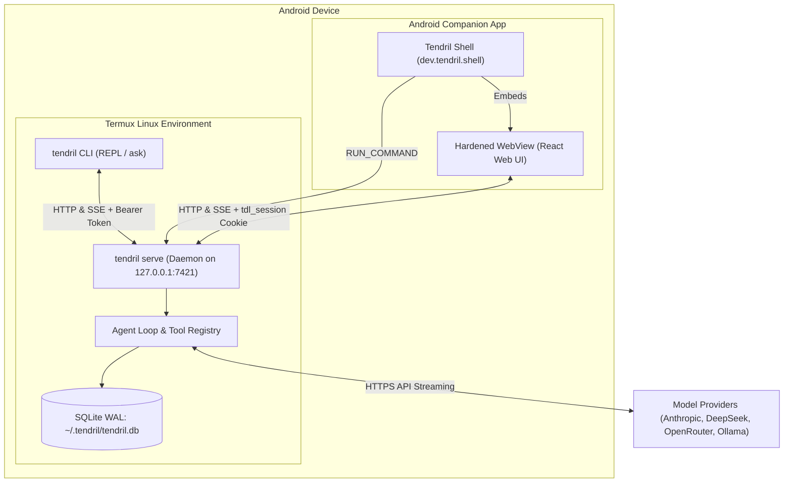

# 🌱 Tendril

[](https://github.com/dzshowrav/tendril/actions/workflows/ci.yml)
[](LICENSE)
[](https://nodejs.org)
[](https://termux.dev)

> **The open-source AI coding harness for Termux on Android.**  
> One headless agent daemon, a Claude-Code-style CLI, and a WebView-based mobile UI — all connected to the same live sessions with instant snapshot review and undo.

---

## ⚡ 60-Second Quick Start in Termux

### Option A: One-Line Automated Installer
Inside Termux on your Android phone, run:

```bash
curl -sL https://raw.githubusercontent.com/dzshowrav/tendril/main/scripts/install.sh | bash
```

The installer verifies Node.js, git, and ripgrep, sets `allow-external-apps = true` in `~/.termux/termux.properties`, builds/links `tendril`, and runs diagnostic health checks.

### Option B: Manual Installation via npm
```bash
# 1. Install prerequisites in Termux
pkg update && pkg install -y nodejs-lts git ripgrep

# 2. Install Tendril globally
npm install -g tendril

# 3. Verify environment
tendril doctor

# 4. Start coding in any project directory
cd ~/my-project
tendril
```

### Option C: Android Companion Shell App
1. Download `tendril-shell-debug.apk` from the latest [GitHub Releases](https://github.com/dzshowrav/tendril/releases).
2. Install the APK on your Android device (Android 8.0+ / API 26+).
3. Ensure `allow-external-apps = true` is set in `~/.termux/termux.properties` (or run `tendril doctor`).
4. Launch the **Tendril** app:
   - If the daemon is stopped, the app cold-starts it in the background via Termux `RUN_COMMAND`.
   - The app automatically pairs with zero manual code entry and connects to your live sessions!

---

## 📐 Architecture at a Glance

```
 Android phone
 ┌──────────────────────────────────────────────────────────────────────────┐
 │  Termux                                                                  │
 │  ┌───────────────┐   HTTP + SSE (127.0.0.1:7421)   ┌──────────────────┐  │
 │  │ tendril (CLI) │ ───────────────────────────────▶│                  │  │
 │  │ REPL / ask    │◀─────────── events ─────────────│   tendril serve  │  │
 │  └───────────────┘      Bearer cliToken            │   (daemon)       │  │
 │                                                    │  ┌────────────┐  │  │
 │  Android apps                                      │  │ agent loop │  │  │
 │  ┌───────────────────────────┐  cookie tdl_session │  │ tools      │  │  │
 │  │ Tendril Shell APK         │ ───────────────────▶│  │ permissions│  │  │
 │  │  WebView ─ React web UI   │◀────── events ──────│  │ providers  │  │  │
 │  │  starts daemon via        │                     │  └─────┬──────┘  │  │
 │  │  Termux RUN_COMMAND       │                     │   SQLite (WAL)   │  │
 │  └───────────────────────────┘                     └─────────┬────────┘  │
 │   (or any phone browser)                                     │ HTTPS     │
 └──────────────────────────────────────────────────────────────┼───────────┘
                                                                ▼
                                                        Model Providers
                                                (Anthropic, OpenRouter, Ollama)
```

### Flow Diagram



---

## ✨ Key Features

- **📱 Designed for Termux on Android:** Zero native addon dependencies (`better-sqlite3`, `node-gyp`, etc. are strictly avoided). Uses Node 24's built-in `node:sqlite` (`DatabaseSync`).
- **🔄 Live Dual-Client Mirroring:** Type in the CLI REPL or tap in the phone WebView — changes, messages, and streaming tokens synchronize live across both clients in real time via Server-Sent Events (SSE).
- **🛡️ Battle-Hardened Security:**
  - Loopback-only binding (`127.0.0.1`).
  - Host header guard (`421 Misdirected Request`) blocks DNS rebinding.
  - Origin guard (`403 Forbidden`) blocks foreign websites.
  - Strict Content-Security-Policy (no `eval`, no inline scripts, DOMPurify markdown sanitization).
  - Unconditional Catastrophic Command Safety Guard blocks destructive commands (`rm -rf /`, `rm -rf ~`, `mkfs`, raw block device writes).
  - Subprocess environment scrubbing strips secret tokens and API keys before spawning commands.
  - Automatic logger redaction ensures API keys never leak into log files.
- **⚡ Instant Snapshot Review & Undo:** Every file write and edit creates an immutable snapshot with unified diffs. Tap **Undo** on the phone or type `/undo` in the CLI to revert any change cleanly.
- **🎛️ Four Permission Modes:**
  - `plan`: Read-only exploration. No file edits or command execution.
  - `ask` (Default): Auto-allows reads; requires approval for edits, commands, network, and system tools.
  - `auto-edit`: Allows in-workspace file edits; prompts for bash execution.
  - `yolo`: Autonomous execution (gated behind explicit `--yolo` flag; hard safety guard still applies).
- **🤝 Two-Client Approval Race:** Simultaneous permission prompts on CLI and Web UI resolve gracefully with first-answer-wins (200 OK) and conflict notification (409).
- **🔌 Multiple Model Providers:** Built-in support for Anthropic Claude 3.5 Sonnet / 3.7 Sonnet, OpenAI-compatible APIs (OpenRouter, DeepSeek, Ollama, Groq, LM Studio) with native streaming tool calling and auto-compaction at 80% context window.
- **📲 Termux:API Tool:** Inspect battery status, camera info, get/set Android clipboard, send push notifications, trigger haptic vibration, or open URLs in the system browser directly from agent turns.

---

## 💻 CLI Commands & Usage

```bash
tendril [dir]                       # Start interactive REPL in project directory
tendril ask "prompt" [options]      # Run a single turn non-interactively
tendril login                       # Interactive wizard to configure model provider credentials
tendril pair                        # Generate one-time 6-digit pairing code
tendril ui                          # Pair and open the Web UI in your phone browser
tendril serve [--detach] [--port N] # Start the background daemon
tendril stop                        # Stop the running background daemon
tendril status                      # Show status, PID, and port of the daemon
tendril logs [-f] [-n lines]        # View daemon log output
tendril doctor [--json]             # Run 10-point diagnostic health check
tendril sessions [list|rm <id>]     # List or manage active sessions
tendril resume [id]                 # Resume an existing session in the REPL
```

### REPL Commands
Inside the interactive REPL (`tendril`), you can use:
- `/mode <plan|ask|auto-edit|yolo>` — Switch permission mode mid-session.
- `/model <model-name>` — Switch the active model.
- `/undo` — Revert the last file modification made in the current session.
- `/diff` — Show unified diff of the most recent change.
- `/files` — List files in the workspace.
- `/ui` — Generate pairing code and open the Web UI.
- `/exit` or `Ctrl-D` — Exit the REPL.

---

## 🔒 Security Model

On Android, Termux runs in a single Linux UID (`u0_a...`) without root or cgroup containers. Tendril implements a defense-in-depth model:
1. **Loopback Only:** Daemon listens exclusively on `127.0.0.1`.
2. **DNS-Rebinding & Origin Guards:** Rejects foreign `Host` and `Origin` headers.
3. **Hard Catastrophic Guard:** Invariant guard refuses destructive commands regardless of user permission mode.
4. **Workspace Boundary:** Symlink and directory traversal escapes (`../`) are strictly blocked.
5. **No Javascript Interface:** The Android Shell WebView communicates solely over local loopback HTTP/SSE with zero `addJavascriptInterface` injection.

See [`SECURITY.md`](SECURITY.md) and [`docs/KNOWN-LIMITS.md`](docs/KNOWN-LIMITS.md) for full security disclosures and platform limits.

---

## 🛠️ Development & Contributing

Contributions are warmly welcomed! You can even develop and run tests directly on your Android phone inside Termux.

```bash
# Clone the repository
git clone https://github.com/dzshowrav/tendril.git
cd tendril

# Install dependencies (zero native addons!)
npm install

# Build Web UI and CLI bundle
npm run build

# Run TypeScript typechecker
npm run typecheck

# Run test suite (157+ unit and integration tests)
npm test

# Run End-to-End journeys & TRD performance budget checks
npm run e2e

# Lint Android Shell security rules
npm run lint:shell
```

Read [`CONTRIBUTING.md`](CONTRIBUTING.md) for full developer guidelines.

---

## 📄 License

Tendril is open-source software licensed under the [MIT License](LICENSE).
